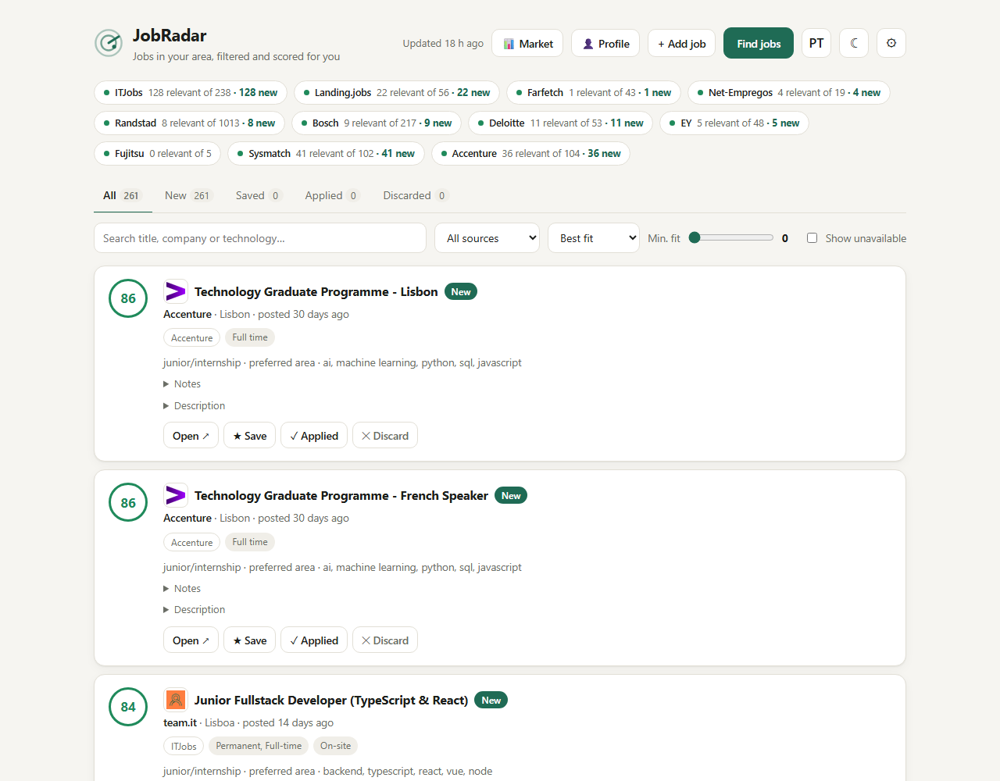
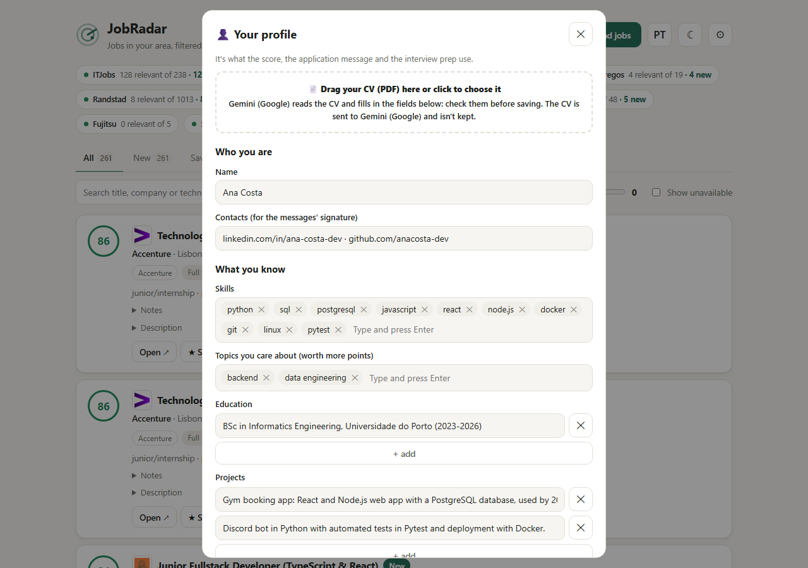
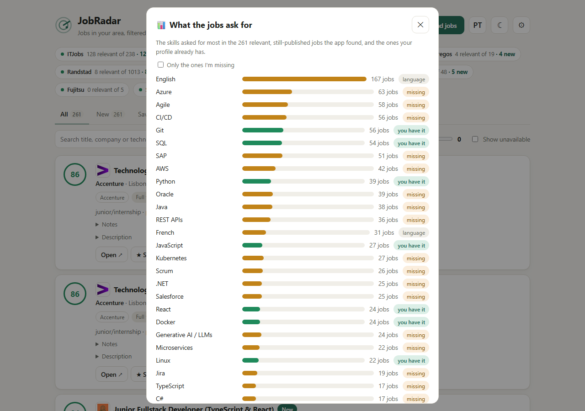
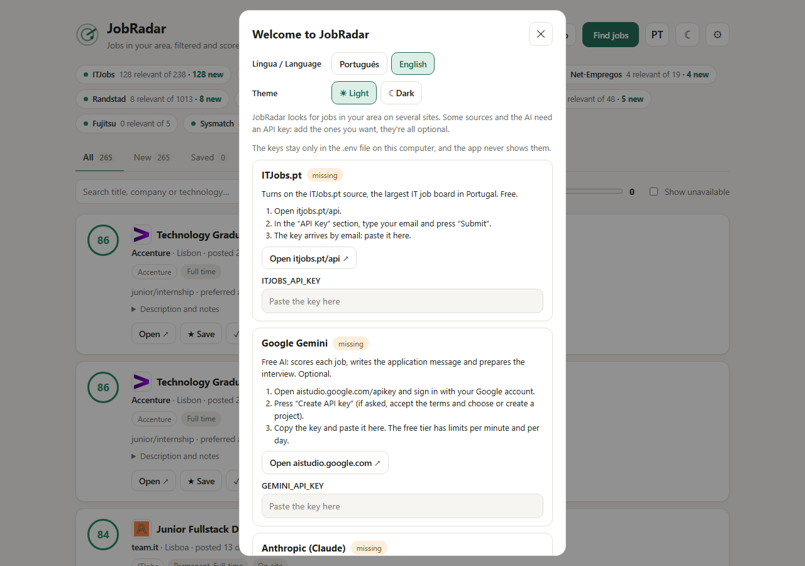

# JobRadar

[](https://github.com/FuzzyLaDuzzy/jobradar/actions/workflows/tests.yml)

A local app that finds jobs in your area of Portugal across job boards and company careers sites, keeps the ones that match the kind of job and level you want, scores each one against your profile, and helps you track your applications. It runs on your own computer, in Portuguese or English.



## Where it looks

Out of the box ([`config.example.yaml`](config.example.yaml)) it reads these job boards and companies. Each one has been checked against its real site; add any other company on the same platforms in a few lines (see [Find the companies in your area](#find-the-companies-in-your-area)).

| Job boards | How |
|---|---|
| **ITJobs.pt** | Official API (free key) |
| **Landing.jobs** | Official feed |
| **Net-Empregos** | Official RSS feed |
| **Randstad** (incl. Randstad Digital) | Official RSS feed |
| **Sysmatch** | Its jobs page |
| **Workable** (every company on Workable, searched in your area) | Public job search |
| **SmartRecruiters** (every company on SmartRecruiters, searched in your area) | Public job search |
| **Work in Braga** (InvestBraga's job board, where companies post themselves) | Its jobs page |

| Company | Platform |
|---|---|
| **Bosch** | SmartRecruiters |
| **Continental** | SmartRecruiters |
| **Farfetch** | Lever |
| **Accenture** | Workday |
| **Aptiv** | Workday |
| **Deloitte** | SAP SuccessFactors |
| **EY** | SAP SuccessFactors (sitemap) |
| **Fujitsu** | SAP SuccessFactors (sitemap) |
| **Uphold** | BambooHR |
| **Mercedes-Benz.io** | Recruitee |
| **Edigma** | Zoho Recruit |
| **Eurotux** | Its jobs page |
| **Balanças Marques** and **SDILAB** (same group) | Their jobs page |
| **Nutrium** | Teamtailor |
| **Coverflex** | Teamtailor |
| **Bloq.it** | Teamtailor |
| **Devoteam** | SmartRecruiters |
| **Jscrambler** | SmartRecruiters |
| **Ubiwhere** | SmartRecruiters |
| **Tonic App** | SmartRecruiters |
| **Euronext** | Workday |
| **HUUB** | Recruitee |
| **Infraspeak** | Teamtailor |
| **Celfocus** | Teamtailor |
| **Critical TechWorks** | Teamtailor |
| **Feedzai** | Greenhouse |
| **Sword Health** | Greenhouse |
| **Cloudflare** | Greenhouse |
| **Jumia** | Greenhouse |

When the same job shows up on two of them (a company's own page and ITJobs, say), it's one card with a link to each.

LinkedIn, Indeed and Glassdoor are left out on purpose (see [Limitations](#limitations)).

## What it does

- **Reads many sources** through the public APIs and feeds that the sites themselves publish:
  - **ITJobs.pt**, the main Portuguese IT job board (free read-only key)
  - **Landing.jobs**, **Net-Empregos** and **Randstad**, through their official feeds
  - **Sysmatch**, **Work in Braga**, **Eurotux** and **Balanças Marques** (with SDILAB), from their jobs pages
  - **Workable**'s and **SmartRecruiters**' public job searches, in your area: every company that hires through them, even the ones you've never heard of
  - **Company careers sites** on SmartRecruiters, Lever, Workday, SAP SuccessFactors, BambooHR, Recruitee, Zoho Recruit, Teamtailor and Greenhouse, from companies all over Portugal (Bosch, Farfetch, Accenture, Deloitte, Devoteam, Feedzai, Sword Health, Cloudflare, Celfocus… or any company you add); each keeps only the jobs in your area
- **Filters** by your area, the kind of job (words the title must have), your level (junior words, senior words to skip), excluded words and companies, job age and typical scam signs. When a source doesn't say where the job is, it looks for the city in the description; when the title names a city outside your area ("Lisbon Based", "Relocate to…"), the title wins.
- **Scores each job from 0 to 100** from keywords (level, area, your skills and interests), with a penalty for jobs that ask for 3+ years. With an AI key, an LLM also scores each new job against your profile and writes one sentence on why.
- **Your profile from your CV** (👤): drop your CV (PDF) and the AI fills in your name, contacts, skills, education, projects, experience and the jobs you're after; check and fix anything before saving, or fill it in by hand. Everything lands in `config.yaml`, which the score, the messages and the interview prep use.
- **Writes a draft application message** (✉) in the posting's language, using only the facts in your profile, and honest about what you're missing.
- **Prepares you for the interview** (🎯): what the job is looking for, likely technical and behavioural questions with hints from your profile, your gaps against the posting, and questions to ask the company.
- **Tailors your CV to each job** (🧩): which of your skills and projects to put first for that job, what it asks for that your profile doesn't show, and words from the posting worth using.
- **Follows a company in one click** (＋): on a job from a job board, **＋ Follow company** looks for that company's careers site on ten platforms and, if JobRadar can read it, adds it to your sources, so its jobs come straight from the company with the full description.
- **Shows what the jobs ask for** (📊 Market): the skills most asked for in the jobs it found, and which ones your profile already has, so you know what to learn next.
- **Shows the salary** (💶) when the posting states one, and filters by it (per month; a yearly amount counts over 14 payments).
- **Shows what the filters cut** (✂ Cut): every job the last search read and left out, with the reason, so a good job cut by mistake can still be saved; saving one offers the filter change that would have kept it, in one click.
- **Warns when a source looks broken**: an error, or no jobs, in its last 3 searches (sites change their pages), or never a single job (maybe none in your area).
- **Learns from your choices**: the AI score gets the jobs you applied to or saved, and the ones you discarded, as examples.
- **Tracks your applications**: mark jobs as saved, applied (with the date) or discarded, and keep notes apart from the description. Jobs you find elsewhere (LinkedIn, a friend…) can be added by hand.
- **Follows them up**: an application moves on to interview, offer or rejected, and the Applied tab sums up how they went (reply rate included). After 7 days with no reply, the card reminds you and the AI writes a short follow-up email. A job the company takes down and posts again keeps your status and notes.
- **Adds a job from its link**: paste it in **+ Add job** and **Read from link** fills in the title, company, place, date and description (not LinkedIn, Indeed or Glassdoor).
- **Exports to CSV** (⬇): your applications, saved and discarded jobs and notes, in a sheet for Excel.
- **Spots jobs that closed**: when a job disappears from its source, it's marked as no longer published.
- **Português or English**: the PT/EN button changes the whole app, the error messages and what the AI writes for you.
- **Light or dark**: the ☀/☾ button (until you choose, it follows your system).

<p>
  
  
</p>

<sub>Screenshots with a made-up profile and real jobs in Lisbon.</sub>

## Install and run

**Windows**: paste this line in PowerShell (Start menu → type "PowerShell"):

```powershell
irm https://raw.githubusercontent.com/FuzzyLaDuzzy/jobradar/main/install.ps1 | iex
```

It finds Python 3.10+ (or offers to install it with winget), puts JobRadar in `%LOCALAPPDATA%\JobRadar` with its own environment, adds it to the Start menu and asks whether to open it when you sign in and to search for jobs every day at 9:00 and 21:00. Then it opens the app.

**macOS / Linux** (with Python 3.10+):

```bash
curl -fsSL https://raw.githubusercontent.com/FuzzyLaDuzzy/jobradar/main/install.sh | sh
```

It installs into `~/.local/share/jobradar`, adds a `jobradar` command and asks whether to add the daily searches to cron.

**To update**, run the same line again: your `config.yaml`, keys, jobs and backups are kept. Want to read the installer first? [install.ps1](install.ps1), [install.sh](install.sh).

### By hand

You need Python 3.10 or later.

**Windows (PowerShell):**

```powershell
git clone https://github.com/FuzzyLaDuzzy/jobradar.git
cd jobradar
python -m venv .venv
.venv\Scripts\Activate.ps1          # if this fails: Set-ExecutionPolicy -Scope CurrentUser RemoteSigned
pip install -r requirements.txt
Copy-Item .env.example .env         # then fill in the keys you have (all optional)
python -m jobradar                  # opens http://127.0.0.1:8000
```

**macOS / Linux:**

```bash
git clone https://github.com/FuzzyLaDuzzy/jobradar.git
cd jobradar
python3 -m venv .venv
source .venv/bin/activate
pip install -r requirements.txt
cp .env.example .env
python -m jobradar
```

The first run creates `config.yaml` from [`config.example.yaml`](config.example.yaml). That file is yours: git ignores it, so updating JobRadar never touches your settings. The 👤 Profile screen opens by itself: drop your CV or fill it in, set your area and level, save, then press **Find jobs**. The first search takes about a minute, because JobRadar reads the full description of every job that passes the first filter.

## Set it up for you

The 👤 Profile screen covers what most people need: who you are, what you know, the kind of job (title words), the area and the level. It only rewrites the values you changed, so the comments and the rest of `config.yaml` stay as they were. Everything else, and the same settings in full, are in `config.yaml`, which you can also edit with the ⚙ button.

| Setting | What it does |
|---|---|
| `language` | `pt` or `en` (the same as the PT/EN button) |
| `search.locations_primary` | Your main place(s). Company sites are searched for these, and jobs there get more points. Add the English name when there is one: `[lisboa, lisbon]` |
| `search.locations` | Every place you accept, e.g. `[lisboa, lisbon, oeiras, amadora, sintra]`. Include your district so ITJobs finds it |
| `search.allow_remote` | `true` to also accept fully remote jobs in Portugal |
| `search.title_keywords` | The kind of job: the title must contain one of these words. The example is for IT; empty list = any job |
| `search.junior_keywords` / `exclude_title_keywords` | Your level: words that mark a junior job (they add points), and title words to skip (senior, lead…) |
| `search.exclude_keywords` / `exclude_companies` | Jobs and companies to ignore |
| `search.max_age_days` | Skip jobs older than this |
| `profile` | Your summary, skills and interests (for the score), plus your name, signature, education, projects, experience and other facts the AI may use in messages (the 👤 screen fills these in) |
| `sources` | Where to look (see below) |

Your area is written only once: ITJobs, Workday and SuccessFactors take it from `search`, unless an entry sets its own (`locations` with ITJobs district ids, `search` on Workday, `location` on SuccessFactors).

### Keys (`.env`)

The first time you open JobRadar, a welcome screen lets you pick the language and a light or dark theme, explains how to get each key and saves the ones you paste to `.env` (they never leave your computer, and the app never shows them again). You can come back to it with ⚙ → 🔑 API keys, or edit `.env` yourself.



| Variable | What for | Where |
|---|---|---|
| `ITJOBS_API_KEY` | The ITJobs.pt source | Free at <https://www.itjobs.pt/api> (sent by email) |
| `GEMINI_API_KEY` | Free AI: scores each job, writes messages and interview notes | <https://aistudio.google.com/apikey> |
| `ANTHROPIC_API_KEY` | The same with Claude, paid (`scoring.llm.provider: anthropic`) | <https://console.anthropic.com> |

Without keys, every source except ITJobs works, and scores use keywords only. With Gemini, JobRadar scores and writes with `gemini-3.5-flash-lite` by default; pick another model in **⚙ Settings → AI model** (the list is the one Google offers your key, newest first), or Claude (Anthropic: Haiku 5.5 scores, Opus 5.5 writes). If a bigger Gemini model is busy, messages switch to the light one. The free Gemini tier has rate limits: jobs it couldn't score are scored on the next refresh. Read Google's terms for how free-tier requests may be used in your region. Always review what the AI writes before sending it.

### Find the companies in your area

The quickest way is in the app: on a job from ITJobs, Landing.jobs or Net-Empregos, press **＋ Follow company**. From the terminal, to look up many at once:

```bash
python -m jobradar discover                         # companies already seen in your area
python -m jobradar discover "Company A" "Company B" # plus these names
```

It takes the companies that already showed up with jobs in your area (plus any names you give), checks ten careers platforms with a public API (BambooHR, Lever, SmartRecruiters, Greenhouse, Workable, Ashby, Recruitee, Personio, Breezy, Teamtailor), says whether the answer mentions your place, and prints the lines to add to `config.yaml`. Watch out for short names: they may match another company with the same name.

To add a company by hand, open one of its job pages and look at the domain of the apply link:

| Platform | Its identifier | In `config.yaml` |
|---|---|---|
| SmartRecruiters | `jobs.smartrecruiters.com/<id>` (case matters) | `- company: BoschGroup`<br>`  country: pt` |
| Lever | `jobs.lever.co/<site>` | `- site: farfetch` |
| Workday | the careers page, `*.myworkdayjobs.com/<Site>` | `- name: Accenture`<br>`  url: https://accenture.wd103.myworkdayjobs.com/AccentureCareers` |
| SAP SuccessFactors | sites like `jobs.<company>...` with a `/search/` page; if the search only works in a browser, `sitemap: true` reads the jobs from `sitemap.xml` | `- name: Deloitte`<br>`  url: https://jobs.deloitte.pt` |
| BambooHR | `<site>.bamboohr.com/careers` | `- name: Uphold`<br>`  site: uphold` |
| Recruitee | `<company>.recruitee.com` (the apply links say which) | `- company: mbio`<br>`  name: Mercedes-Benz.io` |
| Zoho Recruit | careers pages ending in `/jobs/Careers` | `- name: Edigma`<br>`  url: https://careers.edigma.com/jobs/Careers` |
| Teamtailor | `<company>.teamtailor.com`; a site on its own domain also works (`url:`) | `- company: nutrium`<br>`  name: Nutrium` |
| Greenhouse | `job-boards.greenhouse.io/<company>` | `- company: swordhealth`<br>`  name: Sword Health` |

## Run it automatically

`python -m jobradar refresh` runs a search without the interface and prints a summary per source. Net-Empregos only keeps about 24 hours of jobs, so it pays to refresh every day. Each `refresh` first saves a **backup** of the database to `backups/jobradar-YYYY-MM-DD.db` and keeps the last 7. To restore one, close the app and copy it over `jobradar.db`.

**macOS / Linux (cron)**, every day at 9:00 and 21:00:

```cron
0 9,21 * * *  cd /path/to/jobradar && .venv/bin/python -m jobradar refresh >> jobradar.log 2>&1
```

**Windows (Task Scheduler)**, from the project folder in PowerShell:

```powershell
$python = (Resolve-Path .venv\Scripts\pythonw.exe).Path
$action = New-ScheduledTaskAction -Execute $python -Argument "-m jobradar refresh" -WorkingDirectory (Get-Location).Path
$triggers = @((New-ScheduledTaskTrigger -Daily -At 9am), (New-ScheduledTaskTrigger -Daily -At 9pm))
$settings = New-ScheduledTaskSettingsSet -StartWhenAvailable   # runs on boot if the PC was off
Register-ScheduledTask -TaskName "JobRadar refresh" -Action $action -Trigger $triggers -Settings $settings
```

To open JobRadar when you sign in to Windows, add a shortcut to the Startup folder:

```powershell
$shortcut = (New-Object -ComObject WScript.Shell).CreateShortcut("$([Environment]::GetFolderPath('Startup'))\JobRadar.lnk")
$shortcut.TargetPath = (Resolve-Path .venv\Scripts\pythonw.exe).Path
$shortcut.Arguments = "-m jobradar"
$shortcut.WorkingDirectory = (Get-Location).Path
$shortcut.IconLocation = (Resolve-Path jobradar\static\icon.ico).Path
$shortcut.Save()
```

On Windows, JobRadar also:

- opens in a window of its own (Brave, Edge or Chrome in app mode), and if it's already running, only opens the window;
- shows a notification with the best new jobs when a `refresh` finds any (clicking it opens JobRadar). The name and icon are registered for your user only, in `HKCU\Software\Classes\AppUserModelId\JobRadar`;
- writes to `jobradar.log` when started without a console (`pythonw`).

To undo: `Unregister-ScheduledTask -TaskName "JobRadar refresh"`, and delete `JobRadar.lnk` from `shell:startup`.

## On your phone (Android)

JobRadar also runs on an Android phone by itself, with no computer: the app carries Python and the same `jobradar` code, runs its server on the phone and shows it in its own window. Your keys, settings and jobs stay in the app's private storage, and out of Google's cloud backups.

**Install:** download **`JobRadar-…-android.apk`** from the [latest release](https://github.com/FuzzyLaDuzzy/jobradar/releases/latest) on your phone and open it (Android asks once to allow installs from your browser or Files). Each release has the computer installers too.

**Set it up:** the welcome screen asks for the keys, and 👤 **Profile** reads your CV. To bring everything from your computer at once, paste your `config.yaml` into ⚙. The phone keeps its own list: statuses and notes don't sync with the computer.

**Not on the phone yet:** scheduled searches and notifications (press **Find jobs**), ⬇ **Export CSV**, and Claude (the phone has Gemini only).

**How it's built** (`android/`, `.github/workflows/android.yml`): python-for-android's webview bootstrap, built with buildozer on GitHub Actions, for `arm64-v8a` (phones) and `x86_64` (an emulator that installs the APK and checks that the app starts, its page loads, other apps are refused and its own window gets in). Any other app on a phone can reach `127.0.0.1`, so there the API answers only the app's own window, which gets a key made at each start as an HttpOnly cookie. With `ANDROID_KEYSTORE_BASE64` and `ANDROID_KEYSTORE_PASSWORD` in the repository's secrets, the builds are release APKs signed with that key, so each new version installs over the last one; without them (in a fork, say) they are debug builds. A `v` tag (`git tag v1.1.0` and `git push origin v1.1.0`) publishes a release with that version, once the APK passes the emulator; its text is `.github/release-notes.md`.

## Tests

```bash
python -m pytest
```

The tests fake every API's answers, so they run without internet or keys.

## Project structure

```
jobradar/
  sources/          one connector per platform or job board
  filters.py        area, level, kind of job, exclusions, scams, years of experience asked
  scoring.py        keyword score + optional AI score (Gemini or Claude)
  message.py        application message and interview notes
  profile.py        the 👤 Profile screen: its fields, where they go in config.yaml, reading a CV with the AI
  skills.py         the 📊 Market screen: the skills the jobs ask for most
  i18n.py           Português / English
  refresh.py        runs every source, filters, scores and stores; one failing source doesn't stop the rest
  discover.py       finds the careers sites of companies in your area
  db.py             SQLite: jobs, status, notes, history
  app.py            FastAPI
  static/           the interface (Vue 3, no build step)
android/            the Android app: buildozer.spec, main.py (starts the server on the phone), the CV's file chooser
config.example.yaml the starting configuration
tests/              pytest
```

## Limitations

- **LinkedIn, Indeed and Glassdoor are left out on purpose:** they block automated access and their terms forbid scraping. Use their own job alerts, and add the jobs you like with **+ Add job**.
- The sources are Portuguese, so JobRadar is made for jobs in Portugal.
- JobRadar only reads what each site allows in its `robots.txt` and never gets around bot protection. Some sites (for example IEFP) can't be read for that reason.
- The Workday endpoint is the one its careers pages use, but it has no official documentation and may change.
- If a source fails (network, an API change), the others carry on and the error shows at the top of the app.

## License

[MIT](LICENSE) © 2026 Flávio Silva
